# Diagrama de classes Java

Modelo das seis classes persistidas no MySQL. Os campos terminados em `Nome`, `valorPago` e `saldo` são preenchidos pelas consultas com `JOIN` e cálculos; não são colunas próprias da entidade principal.

```mermaid
classDiagram
direction TB

class Cliente {
  -Long idCliente
  -String nome
  -String cpf
  -String telefone
  -String endereco
  -boolean ativo
  +getIdCliente() Long
  +setIdCliente(Long) void
  +getNome() String
  +setNome(String) void
  +getCpf() String
  +setCpf(String) void
  +getTelefone() String
  +setTelefone(String) void
  +getEndereco() String
  +setEndereco(String) void
  +isAtivo() boolean
  +setAtivo(boolean) void
}

class Funcionario {
  -Long idFuncionario
  -String nome
  -String cargo
  -String login
  -String senhaHash
  -boolean ativo
  +getIdFuncionario() Long
  +setIdFuncionario(Long) void
  +getNome() String
  +setNome(String) void
  +getCargo() String
  +setCargo(String) void
  +getLogin() String
  +setLogin(String) void
  +getSenhaHash() String
  +setSenhaHash(String) void
  +isAtivo() boolean
  +setAtivo(boolean) void
}

class FormaPagamento {
  -Long idFormaPagamento
  -String nome
  -String descricao
  -boolean ativo
  +getIdFormaPagamento() Long
  +setIdFormaPagamento(Long) void
  +getNome() String
  +setNome(String) void
  +getDescricao() String
  +setDescricao(String) void
  +isAtivo() boolean
  +setAtivo(boolean) void
}

class VendaFiada {
  -Long idVenda
  -Long idCliente
  -String clienteNome
  -Long idFuncionario
  -String funcionarioNome
  -LocalDateTime dataVenda
  -LocalDate dataVencimento
  -String descricaoCompra
  -BigDecimal valorTotal
  -BigDecimal valorPago
  -BigDecimal saldo
  -StatusVenda status
  -String observacao
  +getIdVenda() Long
  +setIdVenda(Long) void
  +getIdCliente() Long
  +setIdCliente(Long) void
  +getClienteNome() String
  +setClienteNome(String) void
  +getIdFuncionario() Long
  +setIdFuncionario(Long) void
  +getFuncionarioNome() String
  +setFuncionarioNome(String) void
  +getDataVenda() LocalDateTime
  +setDataVenda(LocalDateTime) void
  +getDataVencimento() LocalDate
  +setDataVencimento(LocalDate) void
  +getDescricaoCompra() String
  +setDescricaoCompra(String) void
  +getValorTotal() BigDecimal
  +setValorTotal(BigDecimal) void
  +getValorPago() BigDecimal
  +setValorPago(BigDecimal) void
  +getSaldo() BigDecimal
  +setSaldo(BigDecimal) void
  +getStatus() StatusVenda
  +setStatus(StatusVenda) void
  +getObservacao() String
  +setObservacao(String) void
  +isAtrasada() boolean
}

class Pagamento {
  -Long idPagamento
  -Long idVenda
  -Long idFuncionario
  -String funcionarioNome
  -Long idFormaPagamento
  -String formaPagamentoNome
  -Long idCliente
  -String clienteNome
  -LocalDateTime dataPagamento
  -BigDecimal valorPago
  -String observacao
  +getIdPagamento() Long
  +setIdPagamento(Long) void
  +getIdVenda() Long
  +setIdVenda(Long) void
  +getIdFuncionario() Long
  +setIdFuncionario(Long) void
  +getFuncionarioNome() String
  +setFuncionarioNome(String) void
  +getIdFormaPagamento() Long
  +setIdFormaPagamento(Long) void
  +getFormaPagamentoNome() String
  +setFormaPagamentoNome(String) void
  +getIdCliente() Long
  +setIdCliente(Long) void
  +getClienteNome() String
  +setClienteNome(String) void
  +getDataPagamento() LocalDateTime
  +setDataPagamento(LocalDateTime) void
  +getValorPago() BigDecimal
  +setValorPago(BigDecimal) void
  +getObservacao() String
  +setObservacao(String) void
}

class Cobranca {
  -Long idCobranca
  -Long idVenda
  -Long idFuncionario
  -String clienteNome
  -String funcionarioNome
  -LocalDateTime dataCobranca
  -MeioContato meioContato
  -String resultado
  -LocalDate proximoContato
  -String observacao
  +getIdCobranca() Long
  +setIdCobranca(Long) void
  +getIdVenda() Long
  +setIdVenda(Long) void
  +getIdFuncionario() Long
  +setIdFuncionario(Long) void
  +getClienteNome() String
  +setClienteNome(String) void
  +getFuncionarioNome() String
  +setFuncionarioNome(String) void
  +getDataCobranca() LocalDateTime
  +setDataCobranca(LocalDateTime) void
  +getMeioContato() MeioContato
  +setMeioContato(MeioContato) void
  +getResultado() String
  +setResultado(String) void
  +getProximoContato() LocalDate
  +setProximoContato(LocalDate) void
  +getObservacao() String
  +setObservacao(String) void
}

Cliente "1" --> "0..*" VendaFiada : possui
Funcionario "1" --> "0..*" VendaFiada : registra
VendaFiada "1" --> "0..*" Pagamento : recebe
Funcionario "1" --> "0..*" Pagamento : registra
FormaPagamento "1" --> "0..*" Pagamento : classifica
VendaFiada "1" --> "0..*" Cobranca : origina
Funcionario "1" --> "0..*" Cobranca : realiza
```

Enums: `StatusVenda = ABERTA, PARCIAL, QUITADA, ATRASADA, CANCELADA` e `MeioContato = TELEFONE, WHATSAPP, PRESENCIAL, OUTRO`.
